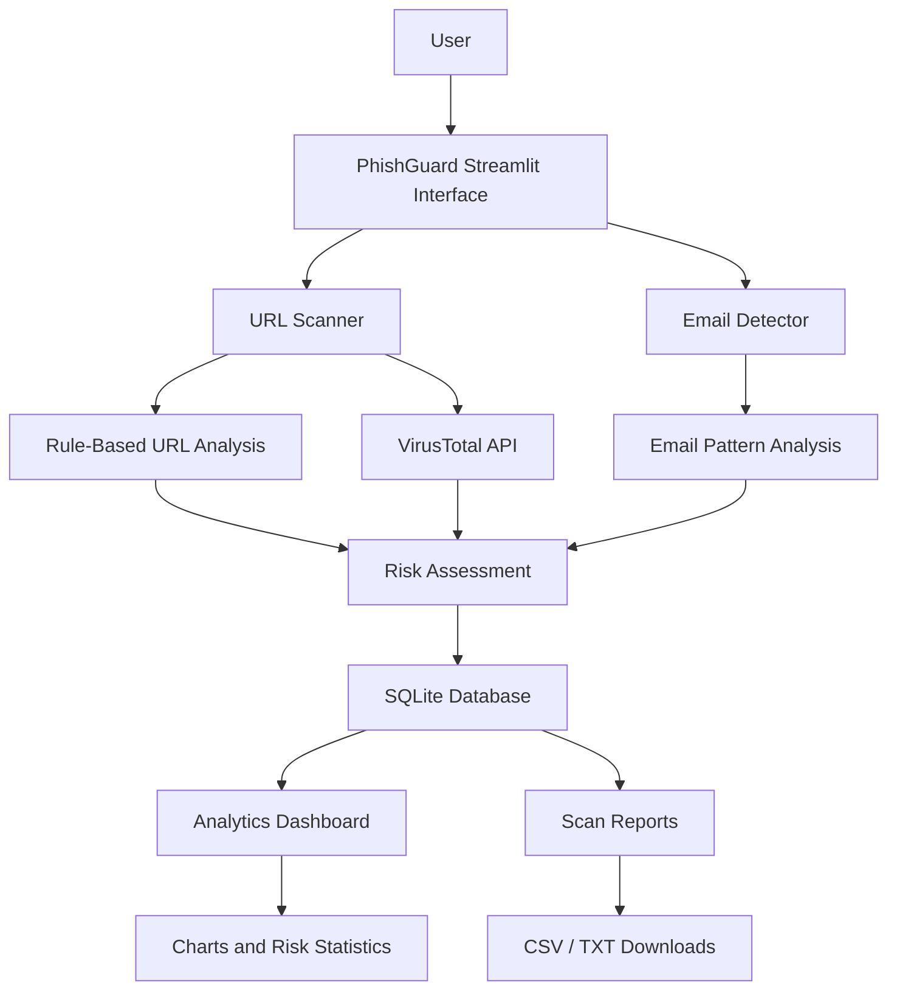

# 🛡️ PhishGuard
### AI-Assisted Phishing Detection & Cybersecurity Analysis

PhishGuard is a web-based cybersecurity application designed to identify suspicious URLs and phishing emails. It combines rule-based security analysis with VirusTotal threat intelligence to help users understand potential online threats.

## 🚀 Features

- **URL Scanner:** Detects suspicious URL characteristics and calculates a risk score.
- **VirusTotal Integration:** Checks URL reputation using VirusTotal threat intelligence.
- **Email Phishing Detector:** Analyzes email content for suspicious patterns.
- **Security Analytics Dashboard:** Visualizes scan statistics, risk distribution and scan activity.
- **Scan Reports:** Stores scan history and supports CSV and TXT downloads.
- **SQLite Database:** Maintains scan records for future analysis.

## 🛠️ Technologies Used

| Technology | Purpose |
|---|---|
| Python | Core programming |
| Streamlit | Web application interface |
| Pandas | Data handling |
| Plotly | Interactive visualizations |
| SQLite | Scan history storage |
| VirusTotal API | URL threat intelligence |

## ⚙️ Application Workflow

1. User enters a URL or email content.
2. PhishGuard performs rule-based security analysis.
3. URL reputation is checked through VirusTotal.
4. Risk information and detection results are displayed.
5. Scan records are stored in the database.
6. Dashboard presents security analytics and reports.
   

## 🏗️ System Architecture



## 📂 Project Structure

```text
PhishGuard/
│
├── app.py
├── url_scanner.py
├── email_detector.py
├── database.py
├── dashboard.py
├── requirements.txt
└── README.md
```

## ▶️ Run Locally

Clone the repository:

```bash
git clone https://github.com/kirnakumari/PhishGuard.git
cd PhishGuard
```

Install dependencies:

```bash
pip install -r requirements.txt
```

Configure your VirusTotal API key using Streamlit secrets:

```toml
VT_API_KEY = "YOUR_VIRUSTOTAL_API_KEY"
```

Run the application:

```bash
streamlit run app.py
```

## 🌐 Live Application

[Open PhishGuard](https://phishguard-security.streamlit.app/)

## 🔐 Security Note

Automated phishing detection is an assistance tool, not a guarantee of safety. VirusTotal results depend on available security engine reports and API availability.

## 👩‍💻 Developer

**Kirna Kumari**

B.Tech CSE | Internet of Things

GitHub: [kirnakumari](https://github.com/kirnakumari)

---

*PhishGuard – Promoting safer digital interactions.*
